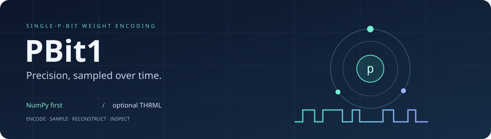
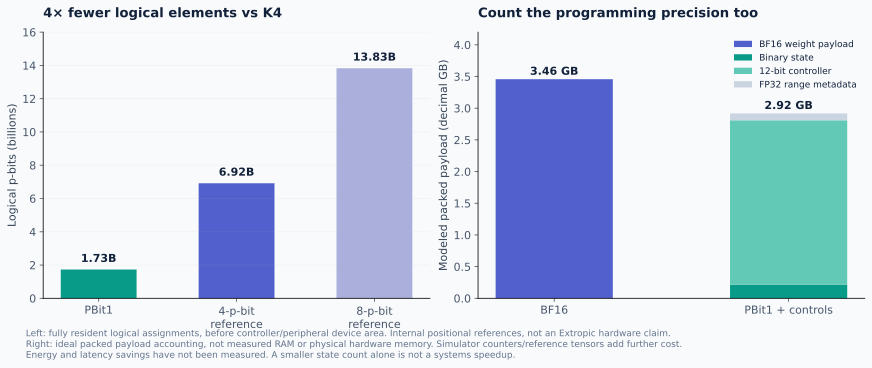

<p align="center">
  
</p>

<p align="center">
  <a href="LICENSE"></a>
  <a href="https://github.com/oramada/pbit1/releases"></a>
  <a href="pyproject.toml"></a>
  <a href="https://github.com/extropic-ai/thrml/tree/2d54cd8404df85bb65703d7e8b4e84e48c1b72a9"></a>
  <a href="https://github.com/oramada/pbit1-extropic"></a>
  <a href="https://github.com/oramada/pbit1/actions/workflows/ci.yml"></a>
</p>

<p align="center">
  <b>One programmable p-bit per learned parameter. Precision supplied over time.</b><br>
  <a href="#the-result">Results</a> · <a href="#install">Install</a> ·
  <a href="#try-it">Quickstart</a> · <a href="#the-cost-tradeoff">Costs</a> ·
  <a href="docs/EXTROPIC_BRIEF.md">Technical brief</a> ·
  <a href="https://github.com/oramada/pbit1-extropic">Experimental archive</a>
</p>

PBit1 is an independent research SDK for representing a weight through the
stationary probability of a programmable probabilistic bit. It includes NumPy
reference encoders, nonideality models, and an integration with **Extropic’s official
THRML simulator**. The accompanying research converts every learned parameter in
**LiquidAI/LFM3-1.7B** and measures the spatial–temporal precision tradeoff.

## The result

**At 8,192 samples, one logical p-bit per parameter passed the original 2% task-quality
criterion against same-fit BF16 across five Monte Carlo seeds.**

| Model coverage | One-p-bit perplexity | Same-fit BF16 perplexity | Upper MC95 degradation |
|:---|---:|---:|---:|
| **1,728,801,536 unique parameters** · 286 canonical tensors | **75.1547** | **75.3147** | **+1.54%**, below the +2% criterion |


All conditions use the same adapted model point and **2,048 fixed teacher-forced
validation targets**. The mean perplexity ratio at T8192 is **0.99788**, with a
conditional 95% t4 Monte Carlo interval of **[0.98062, 1.01544]**. The interval
describes sampling variability on these texts; it is not a fresh-data guarantee or
proof of numerical BF16 precision. BF16 receives the same adapted expected weights,
so additional training is not counted as a representation gain.

Smaller budgets are included: T1024 missed the criterion; T4096 narrowly missed it.
The [experimental archive](https://github.com/oramada/pbit1-extropic) preserves
all three complete cohorts, independent audits, protocols and source hashes.
[Machine-readable figure data](benchmarks/lfm3.json) links directly to that evidence.

**Cross-GPU replay:** the completed K8 spatial-control GB10/H100 bridge produced bit-identical
stochastic and nominal arrays. Its BF16 reference shifted about **0.00515% in
perplexity**. A documented later amendment uses H100-specific BF16 controls while
keeping the original 2% task-quality threshold. The original strict bitwise-control
failure is retained in the archive.

## Verification update · November 5

The completed matched-resource analysis now covers **45 accepted cases** with independent statistical auditing. K1 meets the original quality criterion at C8192; K8 meets it at C1024. Relative to that K8 condition, K1 uses **8× fewer logical p-bits**, **8× more retained scheduled work**, and **64× more temporal samples**. This supports a density/time tradeoff, without establishing hardware energy or latency savings.


The repaired 10,240-target study reached native inference, then was interrupted by Modal preemption. Its completed outputs are preserved. Cloud recovery and producer checkpoint fixtures now pass, and a new versioned first H100 seed has been submitted; the planned report separately covers the 9,728 previously unexposed targets. GPT-2 and DistilBERT data and all 191.4 million learned parameter codes have passed independent audits before scoring. Both actual models passed complete-parameter replacement and independent output replay on synthetic inputs. The full-task 104-case study is running on four parallel H100 jobs; its primary five-seed results are reported below. [Detailed verification update](docs/BROAD_VERIFICATION_20261105.md) · [Dated experimental artifacts](https://github.com/oramada/pbit1-extropic/tree/main/updates/20261105).

The first full-task, five-seed **R1 primary results are mixed** at one logical p-bit per parameter and 8,192 samples:

| Model and full task | Original BF16 | PBit1 | Frozen quality gate |
|:---|---:|---:|:---|
| DistilBERT SST-2 checkpoint · 25,000 IMDb reviews | 87.512% accuracy | 87.532% accuracy | **Passed** · two-percentage-point margin |
| GPT-2 · 283,225 WikiText-2 targets | 25.5024 perplexity | 31.8679 perplexity | **Missed** · 2% relative perplexity margin |

Every learned parameter, including biases and normalization parameters, was converted. Independent audits replayed every evaluation batch from saved official THRML counts. The combined primary criterion failed; these results do **not** establish general BF16 task-quality equivalence. The original 104-case sweep continues unchanged. These are weight-reconstruction results reused across the test task, with dense BF16 software inference, rather than direct stochastic operator execution. [Primary statistics](benchmarks/r1_primary_20261105.json) · [Independent audit](benchmarks/r1_primary_audit_20261105.json).

A distinct higher-budget GPT-2 follow-up is now frozen and running on four H100s: one logical p-bit per scalar, 262,144 samples, five fixed new seeds and the unchanged 2% margin. It uses the already-exposed text corpus and 32× the original sampling work; no new quality result is available. [Protocol and scope](benchmarks/highT_execution_20261105.json).

## Install

The NumPy SDK needs Python 3.12+:

```bash
python -m pip install "pbit1 @ git+https://github.com/oramada/pbit1.git@v0.1.0a1"
```

To include the pinned official CPU THRML backend:

```bash
python -m pip install "pbit1[thrml] @ git+https://github.com/oramada/pbit1.git@v0.1.0a1"
python -m pbit1 --samples 256 --chains 4
```

Wheels and source distributions are available in
[GitHub Releases](https://github.com/oramada/pbit1/releases). This release is
installable from GitHub; it is not advertised as a published PyPI distribution.
The optional simulator extra pins THRML commit
`2d54cd8404df85bb65703d7e8b4e84e48c1b72a9` and the tested dependency versions.
Its installation requires GitHub access and a platform supported by JAX.

## Try it

For weights in `[0,1]`, assign one logical THRML p-bit to each probability:

```python
import numpy as np
from pbit1 import NativeProbabilityBank

weights = np.array([0.1, 0.5, 0.9])
bank = NativeProbabilityBank(weights)  # three logical p-bits; target p = weight
states = bank.sample(seed=7, n_samples=1024, n_chains=4)

estimated_weights = states.mean(axis=(0, 1))
x = np.array([1.0, -0.5, 0.25])
estimated_output = (states @ x).mean()
print(estimated_weights, estimated_output, bank.controls())
```

For signed weights, use shared affine ranges with the NumPy reference encoder:

```python
from pbit1 import SinglePBit

codec = SinglePBit(eps=0)
weights = np.array([[-0.7, 0.2], [0.3, 0.8], [-0.1, 0.4]])
encoded = codec.encode(weights)
output = codec.forward(
    np.array([[1.0, -0.5, 0.25]]), encoded,
    n_samples=8192, rng=np.random.default_rng(7),
)
```

The NumPy reference sampler and official THRML backend are separate implementations.
The SDK exposes the encoding primitives; the full LFM3 conversion and GPU research
worker are in the [archive](https://github.com/oramada/pbit1-extropic).
See [API details](docs/API.md) and the runnable [quickstart](examples/quickstart.py).

## How it works

For a weight in `[0,1]`, program `p = w`, sample `z ~ Bernoulli(p)`, and estimate the
weight by averaging observations. For signed weights, share a center and radius:

$$w_i = c_g + r_g(2p_i-1),\qquad \widehat{w}_{i,T}=c_g+r_g\left(\frac{1}{T}\sum_t(2z_i^{(t)}-1)\right).$$

An isolated THRML spin uses bias `b = logit(p) / (2β)` to obtain the requested
stationary probability. Exact endpoint probabilities use clamped nodes. The
native bank reports float32 bias-control storage explicitly.

Temporal precision has a cost: for independent samples,
`Var(ŵ) = 4 r² p(1−p) / T`. In the full model, finite 12-bit commands and shared
FP32 ranges program the stochastic weights; ACT12 inputs and integer accumulation
feed BF16 nonlinearities. One logical p-bit per parameter does not mean the Python
simulator stores only one bit per parameter.

“FP1” is an informal project/search alias here. **PBit1** describes a programmable
probability representation; it is not an IEEE floating-point format.

## The cost tradeoff

One logical element instead of four gives **75% fewer logical p-bits** than the
internal K4 positional reference. That is the density opportunity being investigated.



The binary-state-only lower bound is 0.216 GB for this model. Counting ideal packed
12-bit controllers and FP32 range metadata brings the modeled payload to **2.918 GB**,
versus **3.458 GB** for BF16 weights. These are payload calculations, not physical
device area or measured simulator memory; counters, readout and reference tensors
add further costs. Conventional low-bit quantization can use less storage.


The successful T8192 validation pass schedules **56.7 trillion retained stochastic
node evaluations per seed**. Matched-work K4 uses T2048 and K8 uses T1024. Completed fixed-subset matched-resource comparisons are reported above; physical matched-quality systems measurements remain pending. Internal K4/K8 references are
not asserted to reproduce Extropic’s proprietary weight representation.

**Energy savings and hardware speedups are not measured.** The plots show where
spatial cost falls and temporal cost rises; they do not turn a logical device-count
reduction into an energy or latency claim.

## Project map

| Repository | Purpose |
|:---|:---|
| **[pbit1](https://github.com/oramada/pbit1)** | Installable SDK, examples, figures, API, package checks |
| **[pbit1-experiments](https://github.com/oramada/pbit1-extropic)** | Dated research snapshot, full cohort reports, protocols, source hashes, reproduction code |

The full experimental archive is currently **private**; access is required for its detailed artifacts. Public benchmark JSON and independent statistical audit summaries are included in this SDK.

The completed result is conditional validation. The 10,240-target study has no accepted full result yet; its original frontend failure is preserved; the repaired run was interrupted by platform preemption; tested checkpoint recovery is now running in a new versioned case. Completed H100 fixed-subset comparisons are included in the verification update.
Physical hardware, drift/calibration at model scale, broad model generalization,
and a drop-in BF16 replacement remain future work.

## Development

```bash
git clone https://github.com/oramada/pbit1.git
cd pbit1
python -m pip install '.[dev]'
python -m pytest -q
python tools/plot_results.py
python -m build
```

Install `.[thrml,dev]` to run the official-backend tests too. The native adapter is
byte-identical to the validated research implementation. Figure generation reads
the audited JSON snapshot rather than handwritten chart values.

## License and attribution

**Apache-2.0** · Copyright 2026 Omar Ramadan and PBit1 contributors.
See [LICENSE](LICENSE), [NOTICE](NOTICE) and [CITATION.cff](CITATION.cff).
THRML, checkpoint weights and datasets retain their own licenses.

This is independent research using Extropic’s official simulator. It is not
affiliated with or endorsed by Extropic or Liquid AI. Stochastic probability
encoding is established; this project investigates the model-level precision and
resource tradeoff. [Technical brief for probabilistic-hardware researchers](docs/EXTROPIC_BRIEF.md).

**Topics:** `pbit1` · `fp1` · `p-bit` · `extropic` · `thrml` ·
`probabilistic-computing` · `stochastic-computing` · `neural-networks` ·
`model-compression` · `quantization` · `bf16` · `monte-carlo` · `llm-inference` ·
`liquid-neural-networks` · `hardware-aware` · `python` · `research` · `reproducibility`.
