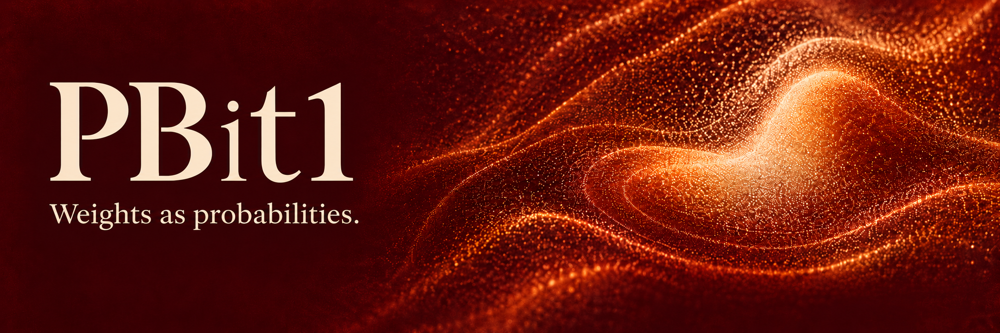
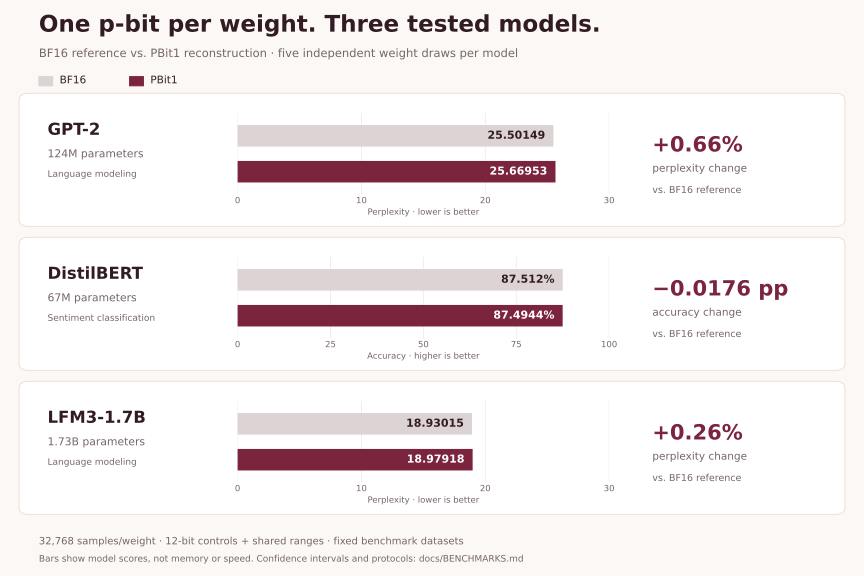

<p align="center">
  
</p>

<p align="center">
  <sub>PBit1 is independent and is not affiliated with or endorsed by Extropic.</sub>
</p>

<p align="center">
  <a href="pyproject.toml"></a>
  <a href="LICENSE"></a>
  <a href="https://github.com/oramada/pbit1/actions/workflows/ci.yml"></a>
</p>

**One p-bit per weight. Precision you can tune.**

PBit1 turns weight arrays into programmable probabilities. Choose a sampling
budget, reconstruct the weights, and measure the result. Explore the balance
between precision and sampling work in ordinary Python—before you need
probabilistic hardware.

Start locally with NumPy. Add Extropic’s official THRML simulator when you want
to explore its sampling backend.

[Try it now](#try-it-now) · [See the benchmarks](#measured-on-pretrained-models) ·
[Getting started](docs/GETTING_STARTED.md)

## Measured on pretrained models

**Three tested models. Up to 1.73 billion parameters. Five weight draws per model.**

The selected research configurations encoded every learned parameter, including
biases and normalization parameters, and met their predefined task-quality
margins against BF16.

<picture>
  <source media="(max-width: 600px)" srcset="docs/assets/product_benchmarks_mobile.svg">
  
</picture>

The chart compares measured task scores. Full-model research runs reconstruct
weights with 32,768 samples per scalar, 12-bit controls, and shared ranges, then
use BF16 neural computation. The datasets were previously inspected; results
are specific to these configurations and tasks.

[Confidence intervals, protocols, and storage costs](docs/BENCHMARKS.md) ·
[Chart data](benchmarks/product_chart.json)

### Spend samples where they matter

In a separate GPT-2 study, a sensitivity-based allocation used **41.7% fewer
nominal reconstruction observations** while passing the same quality margin.
That is the design space PBit1 helps you explore: how much sampling does each
part of a model need?

This was a research policy, rather than an automatic SDK feature. It measures
sampling work, not hardware speed or energy. [See the study](docs/BENCHMARKS.md#less-sampling-work-at-the-same-quality-margin).

## Try it now

Requires Python 3.12+ and Git. No model download or hardware access is needed
for the demo.

```bash
python -m pip install "pbit1 @ git+https://github.com/oramada/pbit1.git@main"
python -m pbit1
```

You’ll see the original result, sampled result, and difference.

## Bring your own weights

```python
import pbit1

program = pbit1.encode([0.1, 0.5, 0.9])
result = program.reconstruct(4096, seed=7)

print(result.weights)
```

Signed weights and NumPy matrices work too. The result keeps your input shape.
Increase the sample count to reduce sampling noise; fix the seed to repeat a
draw in the same software environment.

```bash
pbit1 --samples 4096        # Explore a larger sampling budget
pbit1 --seed 42             # Try a different draw
pbit1 --json                # Inspect controls and diagnostics
```

[Python API](docs/API.md) · [Runnable examples](examples/) ·
[THRML setup](docs/GETTING_STARTED.md#use-thrml)

## Built for experimentation you can trust

- **Prototype locally.** Run with NumPy on your CPU.
- **Tune the tradeoff.** Choose sample counts and local weight groups.
- **Inspect the result.** Compare expected and sampled weights, with explicit storage reporting.
- **Change the sampler.** Use the optional official THRML integration.

The SDK handles array encoding and simulation. Full-model integration and
operator-specific range selection are manual. Probability controls, ranges,
and reconstructed arrays carry additional costs; [the storage guide](docs/BENCHMARKS.md#what-the-storage-numbers-mean)
accounts for them separately.

[Documentation](docs/README.md) · [Report an issue](https://github.com/oramada/pbit1/issues) ·
[Contribute](CONTRIBUTING.md) · [Changelog](CHANGELOG.md) · [License](LICENSE)

Independent software by Omar Ramadan and contributors. Uses Extropic software
without affiliation or endorsement. [Third-party notices](NOTICE).
