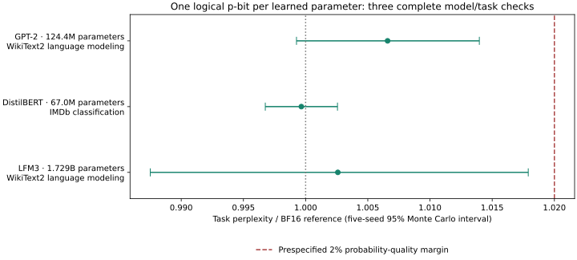

<p align="center">
  
</p>

<p align="center">
  <a href="LICENSE"></a>
  <a href="pyproject.toml"></a>
  <a href="pyproject.toml"></a>
  <a href="https://github.com/oramada/pbit1/actions/workflows/ci.yml"></a>
</p>

<p align="center">
  <b>One programmable probability per parameter. Precision supplied over time.</b><br>
  <a href="#install">Install</a> · <a href="#quickstart">Quickstart</a> ·
  <a href="docs/README.md">Documentation</a> · <a href="#research-results">Results</a> ·
  <a href="CHANGELOG.md">Changelog</a>
</p>

PBit1 is a small Python research SDK for representing numerical weights through
probabilistic bits. Encode weights, reconstruct them from finite samples, and
inspect the cost of probability controls and shared ranges. The default backend
uses **NumPy**; an optional adapter samples with **Extropic’s official THRML**.

The SDK provides encoding primitives and reproducible examples. Full-model
experiments live in a separate research repository; this package is not a
plug-and-play Transformers quantizer.

## Install

Requires **Python 3.12+** and Git. Install the current development version:

```bash
python -m pip install "pbit1 @ git+https://github.com/oramada/pbit1.git@main"
python -m pbit1
```

The default demo needs only NumPy. To use the pinned official THRML CPU backend:

```bash
python -m pip install "pbit1[thrml] @ git+https://github.com/oramada/pbit1.git@main"
python -m pbit1 --backend thrml --samples 1024 --chains 4
```

Use `python -m pbit1 --help` for options and `python -m pbit1 --version` for the
installed version. The `pbit1` command provides the same interface.

For reproducible installations, replace `main` with a commit hash. Earlier tagged
releases and downloadable distributions remain in [GitHub Releases](https://github.com/oramada/pbit1/releases).
The project is distributed through GitHub; these commands do not assume a PyPI release.

## Quickstart

Encode signed weights with finite probability controls, sample a reconstruction,
and use it in an ordinary NumPy operator:

```python
import numpy as np
from pbit1 import FinitePBitProgram

weights = np.array([[-0.7, 0.2], [0.3, 0.8], [-0.1, 0.4]], dtype=np.float32)
inputs = np.array([[1.0, -0.5, 0.25]], dtype=np.float32)

program = FinitePBitProgram.encode(weights, group_size=3)
sample = program.reconstruct(32768, seed=7)

print("Reference:", inputs @ weights)
print("Sampled:  ", inputs @ sample.weights)
print("Storage:  ", program.storage())
```

`sample.weights` is an FP32 array in the original tensor shape. The program uses
12-bit probability commands, shared FP32 ranges, and exact independent-binomial
count sampling. A fixed seed reproduces the reconstruction. The result
approximates the weights; it does not guarantee identical numerical values.

| Interface | Purpose | Backend |
|:---|:---|:---|
| [`FinitePBitProgram`](docs/FINITE_PROGRAM.md) | Finite controls, local ranges, efficient count reconstruction | NumPy |
| [`SinglePBit`](docs/API.md#singlepbit) | Ideal affine encoding with explicit sampled weight tensors | NumPy |
| [`NativeProbabilityBank`](docs/API.md#nativeprobabilitybank) | One logical THRML p-bit for each probability in `[0, 1]` | Optional THRML |

Run [the quickstart](examples/quickstart.py) or [the native probability example](examples/native_probability.py).
See the [API reference](docs/API.md) for shapes, return values, and storage accounting.

## How it works

For a weight in `[0, 1]`, assign `p = w`, sample a binary state, and average its
observations. Signed weights use a shared center and radius:

$$w_i=c_g+r_g(2p_i-1),\qquad \widehat{w}_{i,T}=c_g+r_g\left(2\frac{1}{T}\sum_t z_i^{(t)}-1\right).$$

For independent observations, the ideal estimator variance is
`4 r² p(1 − p) / T`. More samples reduce sampling error; finer local ranges can
reduce its scale. Finite probability controls also introduce error that additional
sampling does not remove.

**One logical p-bit is not one bit of total storage.** Controllers, ranges,
counters, and reconstructed arrays have separate costs. `program.storage()`
reports its array payload and the ideal packed-control alternative explicitly.
“FP1” is an informal project alias, not an IEEE floating-point format.

## Research results

The November 6 DGX Spark study converted every learned scalar in three pretrained
models, including biases and normalization parameters. With selected local ranges,
12-bit controls, and 32,768 samples per scalar:

| Complete model/task | BF16 reference | K1 result | Five-seed quality check |
|:---|---:|---:|:---|
| GPT-2 · 283,225 WikiText-2 targets | PPL 25.50149 | PPL 25.66953 | Ratio 1.00659; MC95 [0.99927, 1.01397] |
| DistilBERT · 25,000 IMDb reviews | Accuracy 87.512% | Mean accuracy 87.4944% | Upper MC95 decline 0.08383 percentage points |
| LFM3-1.7B · 294,442 WikiText-2 targets | PPL 18.93015 | PPL 18.97918 | Ratio 1.00259; MC95 [0.98751, 1.01790] |



All three selected configurations pass their predefined task-quality criteria.
These are **independent-count weight reconstruction followed by BF16 neural
execution**, on previously inspected benchmark datasets. The intervals describe
sampling variability on those fixed data. They do not establish universal BF16
numerical equivalence or physical hardware savings.

A further GPT-2 policy uses **41.7% fewer nominal reconstruction observations**
while passing the same quality margin. It adds 53,088 bytes of range metadata;
its maximum sample count remains 32,768. This is a sampling-work result, not a
measured latency or energy saving.

The failures matter too: original-layout GPT-2 misses the quality margin at the
same budget. Output-head diagnostics identify range orientation as a cause.
A stronger four-element native control achieves lower operator error than K1
at matched scheduled observations, using more elements and control information.

[Detailed results and limitations](docs/SPARK_VERIFICATION.md) ·
[Public benchmark data](benchmarks/spark_cross_model_20261106.json) ·
[Sampling-budget audit](benchmarks/spark_reduced_work_audit_20261106.json) ·
[Earlier experiments](docs/HISTORY.md)

## Documentation and research

| Resource | What you will find |
|:---|:---|
| [Documentation](docs/README.md) | Installation, examples, API, and experiment guides |
| [Technical brief](docs/EXTROPIC_BRIEF.md) | Representation, evidence, and hardware questions |
| [Research repository](https://github.com/oramada/pbit1-research) **(private)** | Manuscript, figures, research code, and audited artifacts |
| [Original experimental archive](https://github.com/oramada/pbit1-extropic) **(private)** | Preserved earlier protocols and outcomes |

The public SDK includes benchmark summaries. Access to the complete private
research repositories must be granted separately. Large model and dataset assets
remain subject to their own licenses and restoration requirements.

## Development

```bash
git clone https://github.com/oramada/pbit1.git
cd pbit1
python -m pip install '.[dev]'
python -m pytest -q
python examples/quickstart.py
python -m build
```

Install `.[thrml,dev]` to include the official-backend tests. Contributions and
reproducible bug reports are welcome; see [CONTRIBUTING.md](CONTRIBUTING.md).

## License and attribution

[Apache-2.0](LICENSE) · [Third-party notices](NOTICE) · [Citation](CITATION.cff)

Independent research by Omar Ramadan and contributors. The project uses Extropic
software without affiliation or endorsement. THRML, model checkpoints, and
datasets retain their own licenses.
