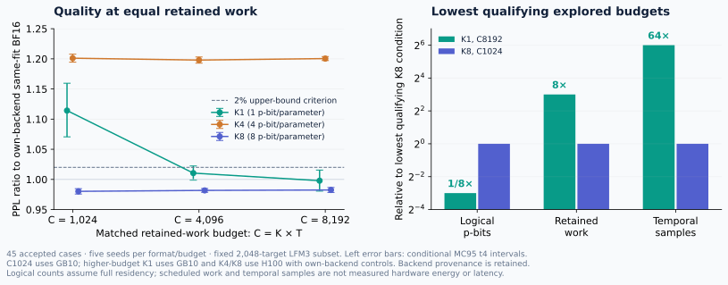

# Broad verification · 2026-11-05

The complete matched-work analysis now covers **45 accepted cases**, with five seeds for every format/budget condition. An independent Decimal audit checks original case bindings, controls, statistical intervals, parameter-point hashes, backend labels and retained/warmup work. No duplicate H100 replay key is pooled as an extra seed.

| Budget C | Format | GPU backend | PPL | Upper MC95 PPL ratio to own BF16 | Original 2% gate |
|---:|:---|:---|---:|---:|:---|
| 1,024 | K1 | GB10 | 83.9167 | 1.1596 | Missed |
| 1,024 | K4 | GB10 | 90.4592 | 1.2077 | Missed |
| 1,024 | K8 | GB10 | 73.8239 | 0.9847 | Passed |
| 4,096 | K1 | GB10 | 76.1024 | 1.0223 | Missed |
| 4,096 | K4 | H100 | 90.2283 | 1.2031 | Missed |
| 4,096 | K8 | H100 | 73.9443 | 0.9849 | Passed |
| 8,192 | K1 | GB10 | 75.1547 | 1.0154 | Passed |
| 8,192 | K4 | H100 | 90.4163 | 1.2038 | Missed |
| 8,192 | K8 | H100 | 73.9985 | 0.9867 | Passed |

All conditions use the same adapted point and 2,048 fixed targets. C1024 uses complete GB10 cohorts. Higher-budget K1 is GB10 and K4/K8 are H100 with backend-specific BF16 controls. Cross-format contrasts are descriptive, with both raw NLL and own-control gap differences reported. Tiny CPU float64 reduction differences are retained as per-seed control values. These are conditional exploratory comparisons, not fresh-data results or a universal guarantee.

**The supported tradeoff:** K1 meets the criterion at the lowest explored qualifying budget C8192; K8 meets it at C1024. This corresponds to eight times fewer logical p-bits for K1, but eight times more retained scheduled work and 64 times more temporal samples than that K8 condition. K4 misses the quality gate at all three explored budgets. No measured energy or hardware latency advantage follows from these counts.

## Repaired full-data evaluation

The first attempt failed when a rank-three frontend encountered per-head attention normalization. The versioned frontend now passes actual model forwards at 8×65 and 4×257, all 287 weighted module uses, and 12 canonical layout fixtures including rank-four head axes. CPU, GB10 and H100 component audits matched 4,194,304 public sampler bits and 3,962,880 integer/FP64 outputs exactly.

The first two short articles had completed BF16 control evaluation before the original failure. An exposure ledger records those 512 targets. The new protocol keeps all 10,240 targets/40 articles and separately analyzes the 9,728 previously unexposed targets/38 articles. Both reports must meet the unchanged 2% criterion with conditional MC and crossed article/seed bootstrap bounds for short,long,andpooled. Five fresh keys are 202611150–202611154. The first H100 case completed its first native batch, then the CPU campaign was preempted and rescheduled. The subsequent attempt failed; completed outputs are preserved. Deployed CPU recovery fixtures now verify atomic rejection of duplicate submissions, durable call handles and cross-container stage skipping with official THRML. A first integration exposed an absolute/relative path defect during BF16 control output; that failed attempt is preserved and performed no native sampling. The corrected producer passed direct checkpoint-writer regression fixtures and the corrected scientific v4 runner is now submitted through a validated v5 transport wrapper. A preceding launch guard rejected an old log-directory reference before core inference; that terminal call and all earlier failed artifacts are preserved. Remaining four seeds start only after its independent case audit. No completed fresh-data quality claim is made.

Recovery keeps all original keys and criteria. Six legacy outputs are replayed under the same key to regenerate missing receipts, with bitwise output comparison and separately recorded duplicate work. Closed v4 stages retain hashes, losses, module coverage and receipts so infrastructure resumption skips them. Deterministic control tensors still require bit equality; only the FP64 loss-reduction guard permits at most 1e-12 absolute difference, with every seed loss retained.

## Additional model selection, before scores

- [GPT-2](https://huggingface.co/openai-community/gpt2): 124,439,808 unique learned scalars, including 102,144 bias values; planned language-model evaluation on the pinned WikiText-2 test corpus.
- [DistilBERT SST-2 checkpoint](https://huggingface.co/distilbert/distilbert-base-uncased-finetuned-sst-2-english): 66,955,010 unique learned scalars, including 52,226 bias values; planned domain-shift sentiment evaluation on the [IMDb test set](https://huggingface.co/datasets/stanfordnlp/imdb).

Checkpoint/dataset revisions, file hashes, alias inventories, complete parameter coverage, samples, seeds and primary quality criteria were selected before any new-model quality evaluation. Pinned checkpoint and dataset bytes have now passed SHA256 or Git-blob verification, and token geometry is frozen without model forwards. GPT-2 covers all 283,225 within-article predicted targets across 62 articles, with at most 1,024 context tokens and stride 512. DistilBERT retains all 25,000 IMDb test reviews at 256 tokens; 43.36% are truncated. Synthetic layout fixtures check exact target coverage and article boundaries. An independent audit rebuilt every test token, target window and label from the pinned dataset/tokenizer files, using a different article parser and batch layout. The implementation, component, full-model replay and statistical execution gates subsequently passed before task scoring; completed primary outcomes are reported below. R1 reconstruction and R2 operator execution are separate regimes and will be reported separately; an R1 result cannot establish R2 hardware costs.

## Complete-parameter and sampler gates

All **191,394,818 learned scalars** now have independently audited finite-control programs: GPT-2 contributes 124,439,808 scalars in 148 canonical tensors; DistilBERT contributes 66,955,010 in 104 tensors. The audit checks every command, local range, BF16 source value and alias against pinned raw safetensors. It accounts for the GPT-2 checkpoint's bare parameter names and verifies its 12 fixed causal masks separately as unlearned state. The original prefix-mismatch audit failure is preserved.

CPU/H100 replay matched all 1,376,256 public sampler bits and count values exactly. A separate primary-budget H100 fixture checked all **1,610,612,736 bits** across K1/K4/K8 using 65,536 sampler lanes, including padding, constants and a short final group. Independent packed-byte population counts and rational-count readouts agree with the official THRML observer. These are primitive checks, not additional neural accuracy results.

The recovered LFM3 study completed its first native batch and matched all four legacy stage outputs bit for bit. Complete 16-batch case audits and the five-seed quality analysis remain pending.

Controller and metadata costs are explicit: the K1 programs use 12 control bits per scalar and two float32 range values per group. One logical p-bit per parameter does not imply one-bit total storage. R1 evaluation will reconstruct BF16 weights in software; its timing and memory cannot establish an R2 or physical hardware advantage.

## Full-task R1 study now running

The complete execution and statistical protocol was frozen before the first actual-model task score. **104 cases** cover 14 deterministic controls and 90 stochastic cases: two models × three work budgets × K1/K4/K8 × five fixed seeds. The primary condition remains K1 at C8192. Existing 2% log-perplexity and two-percentage-point accuracy margins are unchanged; both original BF16 and finite-program-mean BF16 comparisons must satisfy the paired MC and data-bootstrap criteria.

Both actual pretrained models first passed all seven controls and a complete-parameter native T1 draw on synthetic inputs, with every BF16 weight and output independently replayed. The first preflight launch failed on nonportable local source paths before model loading; a new version corrected only path portability and retained the original core code and synthetic keys. Real-data batch/label/target alignment and statistical-cohort fixtures also passed before scoring.

Four durable H100 jobs now evaluate the full pinned tasks. Completed cases require an independent replay from saved parameter counts, without new sampling, and bit-identical hashes for every output batch. All classifier logits are retained; language-model outputs retain full batch hashes and target-loss components, with complete neural replay providing verification without storing terabytes of logits. The initial timestamped snapshot recorded 12 completed deterministic controls. The primary study now has all 14 controls and 10 native cases independently audited, followed by an independent statistical audit.

The R1 stochastic work budget is **per model reconstruction draw**, reused across the fixed evaluation examples. It must not be presented as per-input R2 execution cost or GPU memory compression. Uniform min/max INT2/4/8 controls include every learned parameter and do not represent specialized production quantization kernels.

## Independently audited primary outcomes

The first full-task, five-seed **R1 primary results are mixed** at one logical p-bit per parameter and 8,192 samples:

| Model and full task | Original BF16 | PBit1 | Frozen quality gate |
|:---|---:|---:|:---|
| DistilBERT SST-2 checkpoint · 25,000 IMDb reviews | 87.512% accuracy | 87.532% accuracy | **Passed** · two-percentage-point margin |
| GPT-2 · 283,225 WikiText-2 targets | 25.5024 perplexity | 31.8679 perplexity | **Missed** · 2% relative perplexity margin |

Every learned parameter, including biases and normalization parameters, was converted. Independent audits replayed every evaluation batch from saved official THRML counts. The combined primary criterion failed; these results do **not** establish general BF16 task-quality equivalence. The original 104-case sweep continues unchanged. These are weight-reconstruction results reused across the test task, with dense BF16 software inference, rather than direct stochastic operator execution. [Primary statistics](../benchmarks/r1_primary_20261105.json) · [Independent audit](../benchmarks/r1_primary_audit_20261105.json).

Against original BF16, the GPT-2 perplexity ratio is **1.24960**, with conditional MC95 t4 interval **[1.20938, 1.29117]** and crossed article/seed bootstrap interval **[1.22172, 1.27513]**. Both upper bounds exceed 1.02. The DistilBERT error-rate gap is **−0.0200 percentage points**, with MC95 interval **[−0.11476, +0.07476] pp** and crossed review/seed bootstrap interval **[−0.11680, +0.07840] pp**. Both upper bounds are below the frozen +2 pp margin. The same pass/miss outcomes hold against finite-program-mean BF16 controls. Each model uses five independent reconstruction draws, evaluated separately; predictions are not ensembled.

The finite-mean GPT-2 control NLL is 3.237656 versus original BF16 3.238772, whereas sampled K1 NLL is 3.461599. This is consistent with finite-sample sensitivity, but does not yet identify a causal layer or exclude all implementation faults. A separate read-only count-moment diagnostic is checking the saved draws without new sampling. Any follow-up will retain the original failed primary condition, frozen margins and complete sweep. Group size is 128; probability commands have 12-bit precision, and both float32 range values per group are counted.

## Inspect and verify

The experimental archive is private at the time of this update. Public aggregate benchmark JSON and independent statistical audit summaries are included in the SDK; the detailed case/source archive requires access.

[The experimental update](https://github.com/oramada/pbit1-extropic/tree/main/updates/20261105) contains `INDEX.json`, which maps original paths to preserved archive artifacts and SHA256 digests. The experimental archive’s original [root manifest](https://github.com/oramada/pbit1-extropic/blob/main/FILES.sha256.json) and `snapshot-20261031` release remain unchanged. The dated update has its own manifest. Checkpoints, dataset arrays, raw logits and trajectories remain outside GitHub; the included audits preserve their original hashes.

The broad-verification goal remains active. Additional models/tasks, nonideality operating regimes and practical systems accounting remain required. Physical hardware access is required for measured device energy/latency claims.
