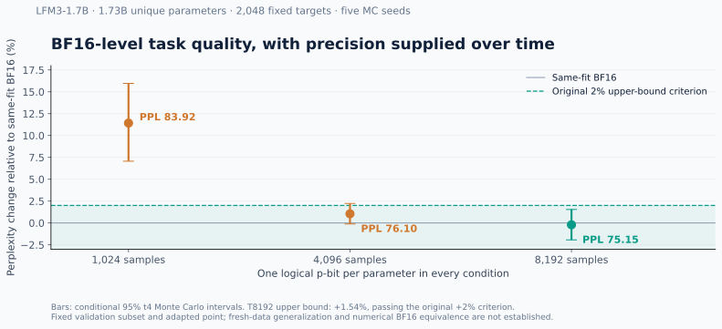
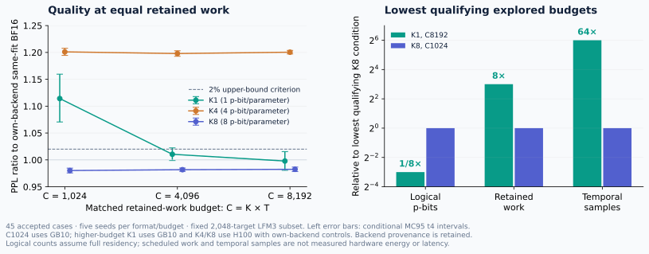

# Earlier experiments

These results are retained for context and must not be pooled with the newer
original-checkpoint evaluations in [DGX Spark verification](SPARK_VERIFICATION.md).
The [original public README](https://github.com/oramada/pbit1/blob/35ee2eea04ac727e886a22ed954064b602b76a90/README.md)
and the private experimental archive preserve the earlier descriptions.

## Adapted LFM3 checkpoint

The earlier study converted all 1,728,801,536 unique learned parameters of
LiquidAI/LFM3-1.7B and evaluated 2,048 fixed teacher-forced validation targets.
All conditions shared the same adapted expected weights; the reference was
same-fit BF16 with perplexity 75.3147.

| Samples | Mean perplexity | PPL ratio, five-seed MC95 | Original 2% upper-bound criterion |
|---:|---:|---|---|
| 1,024 | 83.9167 | 1.1142 [1.0706, 1.1596] | Missed |
| 4,096 | 76.1024 | 1.0105 [0.9988, 1.0223] | Missed |
| 8,192 | 75.1547 | 0.99788 [0.98062, 1.01544] | Passed |

These intervals describe Monte Carlo variability on the fixed texts. They do
not establish new-data generalization or numerical BF16 equivalence. The
historical implementation retained finite probability commands, local ranges,
ACT12 inputs, integer accumulation, and BF16 nonlinearities. Those execution
details should not be applied to the newer independent-count/BF16 experiments.

[Earlier figure data](../benchmarks/lfm3.json)

## Matched resources and cross-GPU replay

The completed earlier matched-resource analysis covered 45 accepted cases.
K1 reached its quality criterion at C8192 and K8 at C1024. Relative to that K8
condition, K1 used eight times fewer logical p-bits, eight times more retained
scheduled work, and 64 times more temporal samples. This measures a density/time
tradeoff, not a hardware energy advantage.

The GB10/H100 bridge reproduced stochastic and nominal arrays bit-for-bit. Its
BF16 reference shifted about 0.00515% in perplexity. The original strict
bitwise-control failure is retained alongside the later documented amendment
using device-specific BF16 references with the same 2% quality margin.

## Failed and interrupted conditions

The November 5 full-task cohorts included failing GPT-2 and passing DistilBERT
conditions. A later 10,240-target LFM3 cloud evaluation was interrupted and has
no accepted final quality result. Those outcomes remain in the archive; they
are not additional evidence for the completed November 6 results.

[November 5 details and nonideality controls](BROAD_VERIFICATION_20261105.md)

The subsequent local investigation diagnosed GPT-2's output-head range grouping,
validated a repair at matched sampling count, and evaluated the original
pretrained LFM3 checkpoint. See [the current study](SPARK_VERIFICATION.md) for
those separate cohorts and their limits.
